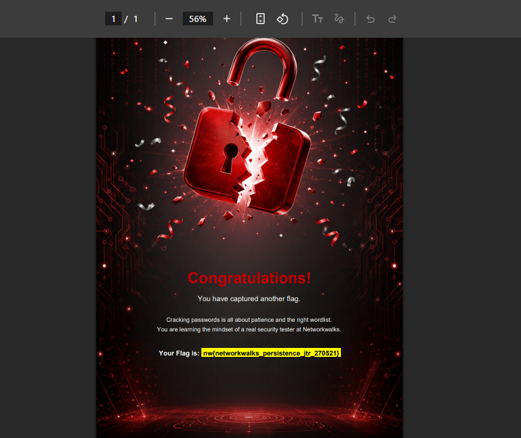

# Module 1 — Password Cracking with John the Ripper (JTR)

**Course:** Week 3 | Project Module 1
**Tools:** John the Ripper (CLI), Johnny (GUI front-end for JTR), OnlineHashCrack PDF hash extractor
**Target:** `My Locked PDF1.pdf` (password-protected sample file)

## Background

John the Ripper is a long-standing, cross-platform password-auditing tool capable of cracking many hash types, including those used to protect PDF, ZIP, and Office files. Johnny provides a GUI on top of JTR so the same attacks can be run without the command line.

## Methodology

1. **Install tooling** — Downloaded John the Ripper and the Johnny GUI, then pointed Johnny at the `john.exe` executable under Settings.
2. **Extract the hash** — Uploaded the locked PDF to an online `pdf2john` hash extractor to produce a hashcat/JTR-compatible hash string (format: `$pdf$...`).
3. **Prepare the hash file** — Copied the hash into a plain-text file (`hash1.txt`), making sure no stray characters (e.g. a leading `b'`) were left over from the extraction step.
4. **Load into Johnny** — Opened the hash file via *Open password file* in Johnny.
5. **Run the attack** — Started the cracking attack from the Johnny GUI, which invokes JTR against the hash.
6. **Recover the password** — JTR successfully cracked the hash, returning the plaintext password.
7. **Unlock the file** — Opened the original PDF and entered the recovered password to confirm access.

## Result

✅ Password successfully recovered and verified by opening the target PDF.

**Captured flag:**
`nw{networkwalks_persistence_jtr_270521}`

## Key Takeaway

Even a well-regarded, widely used cracking tool like JTR can recover a weak password almost instantly once the hash is extracted — underscoring why password complexity and length matter far more than obscurity of the cracking tool.
