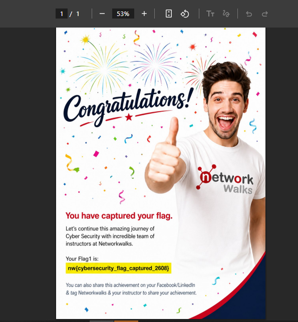

# Module 2 — Password Cracking with NetworkWalks Browser Tools

**Course:** Week 3 | Project Module 2
**Tools:** NetworkWalks Hash Calculator, NetworkWalks Password Cracker (both browser-based, no install required)
**Target:** `My Locked PDF1.pdf` (password-protected sample file)

## Background

Locked files such as PDFs store their password as a hash rather than in plaintext. To recover the password, the hash must first be extracted from the file, then run through a cracking tool that tests candidate words from a wordlist until it finds a match. This lab repeats the same core workflow as Module 1, but using NetworkWalks' own lightweight, browser-based tools instead of installed desktop software.

## Methodology

1. **Download the target file** — Retrieved `My Locked PDF1.pdf` from the lab resource page.
2. **Extract the hash** — Uploaded the file to the NetworkWalks Hash Calculator, which parses the PDF locally in-browser and returns a crackable hash beginning with `$pdf$...`.
3. **Copy the full hash** — Carefully copied the entire hash string, since a partial copy would cause the attack to fail.
4. **Run the dictionary attack** — Pasted the hash into the NetworkWalks Password Cracker, which tests each word in a wordlist against the hash (the same underlying approach JTR uses).
5. **Observe the match** — The tool iterated through its built-in wordlist and reported a successful match.
6. **Unlock the file** — Entered the cracked password into the PDF reader's password prompt to confirm it was correct.

## Result

✅ Password successfully recovered and verified by opening the target PDF.

**Captured flags:**
- `nw{cybersecurity_flag_captured_2608}`
- `nw{networkwalks_flag_260821_1}` *(bonus flag from completing the full exercise)*

## Key Takeaway

The underlying technique — extract hash → dictionary attack → recover plaintext — is identical whether using an installed tool like John the Ripper or a simple browser-based utility. This reinforces that the strength of a password, not the sophistication of the attacker's tooling, is the real line of defense.
